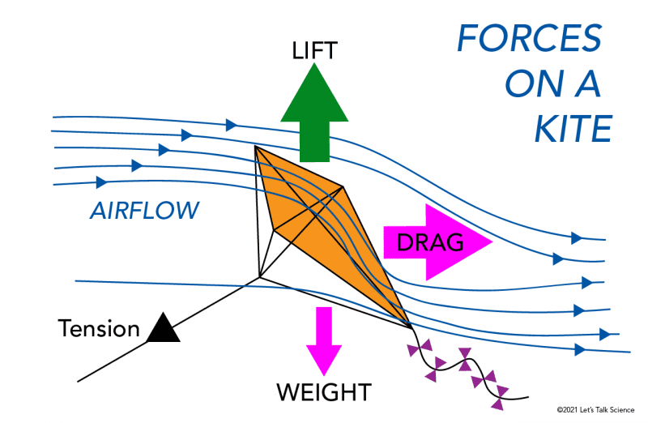
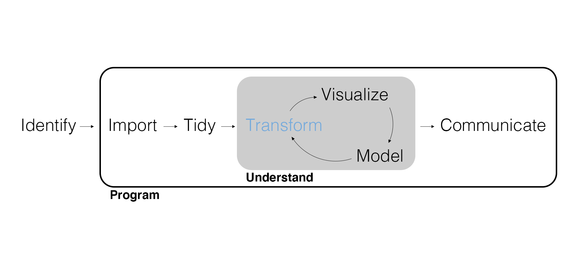
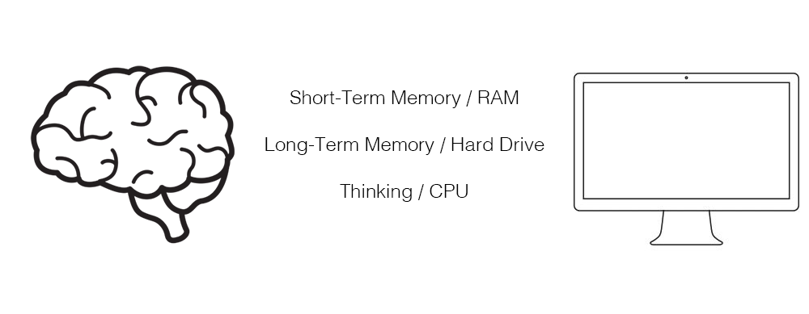
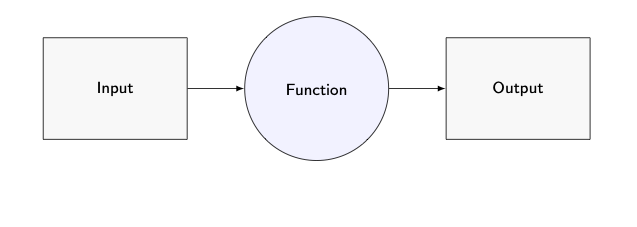
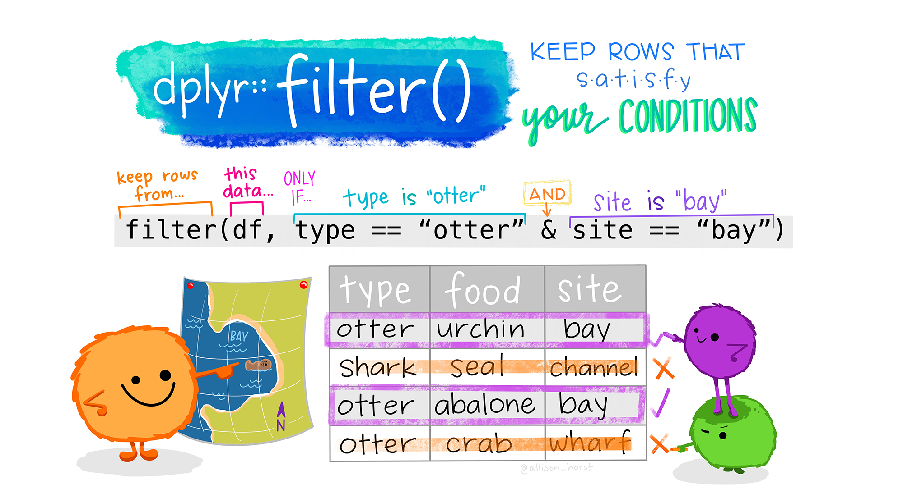
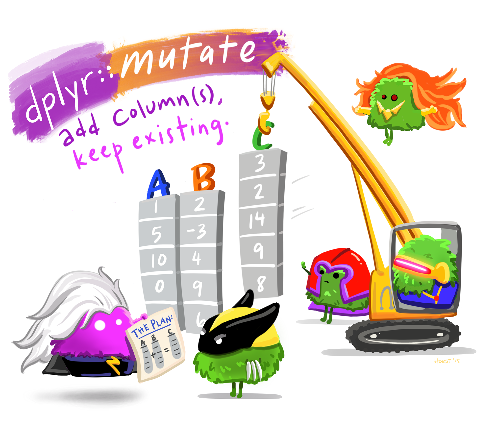
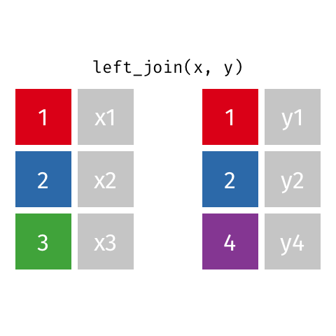
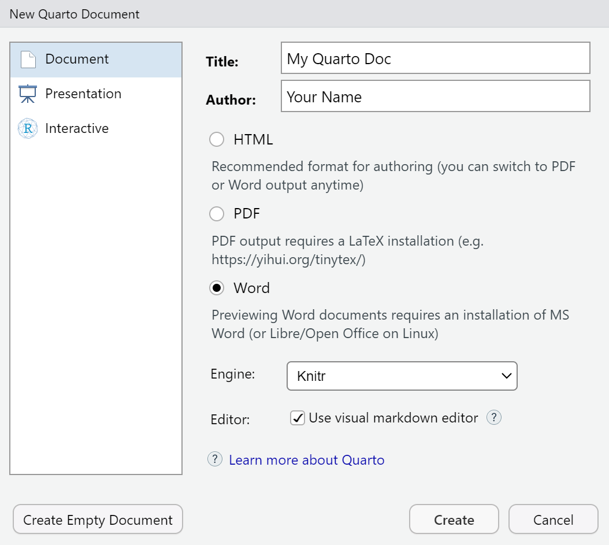

## Remember, Remember

> “O remember, remember, my son Helaman, how strict are the commandments of God. And he said: If ye will keep my commandments ye shall prosper in the land—but if ye keep not his commandments ye shall be cut off from his presence.”

— [Alma 37:13](https://www.churchofjesuschrist.org/study/scriptures/bofm/alma/37?lang=eng&id=p13#p13)

Selected in Elder Chi Hong (Sam) Wong's [“Remember, Remember,” April 2026 general conference](https://www.churchofjesuschrist.org/study/general-conference/2026/04/52wong?lang=eng).

## The Kite and the String

In President Dallin H. Oaks's analogy, a boy wants to cut his kite's string, believing this will let it fly higher.

> “His wise father counseled no, explaining that the string is what holds the kite in place against mortal winds. If we lose our hold on the string, the kite will not rise higher. It will be carried about by these winds and will inevitably crash to the earth.”

— President Dallin H. Oaks, quoted in Elder Chi Hong (Sam) Wong's [“Remember, Remember,” April 2026 general conference](https://www.churchofjesuschrist.org/study/general-conference/2026/04/52wong?lang=eng).

## Forces on a Kite

<center>

</center>

<div style="font-size: 16px;">Image: © 2021 Let's Talk Science, via [Fly360](https://fly360.co.in/the-physics-of-kite-flying-understanding-the-forces-and-design-for-stable-flight/).</div>

## Today's Learning Goals

By the end of class, you should be able to:

- Explain how files, working directories, and R objects relate.
- Import and inspect a CSV file.
- Transform rows and columns with core {dplyr} verbs.
- Join two data frames and connect steps with `|>`.

## Marketing Analytics Process

<center>
{width=900px}
</center>

## Let's Get Set Up With R and RStudio

<center>
{width=900px}
</center>

## Computer Orientation

Your **RAM** limits how much data R can hold in memory, while your **CPU** affects how quickly many calculations run. In RStudio, the Environment shows objects currently in memory; the Files pane shows files stored on disk.

<center>
{width="850px"}
</center>

---

The hard drive (i.e., hard disk) is used for:

- Installing packages.
- Writing and rendering files.

RAM (i.e., random access memory) is used for:

- Loading packages.
- Importing, wrangling, visualizing, and modeling.

## Files and Folders

A hard drive is composed of **files** (e.g., .csv, .rds, .R, .qmd, .exe) organized into **folders**/**directories**. It is critical to organize your work.

Every file on your computer has a kind of address called a **file path**. A relative path such as `"customer_data.csv"` starts from the current working directory.

## A Word About Downloading and Organizing Files

One of the most important skills you should strive to develop is the ability to
organize and manage files! 

- Create a MKTG-411 folder on your computer.
- Every file you download for this class should live in this folder, organized by **unit** and **lecture**.
- **NEVER** work out of your Downloads folder.
- Download the data for the first Unit, and the items for Lectures 1 and 2 from Canvas, and move them **to their own folders** inside your MKTG-411 folder.

## R and RStudio Orientation

- Console: Where you run code and perform calculations.

```{r}
#| eval: false
5 + 5
```

- We will use lots of Quarto documents in this class, which allow you to write and 
run code in chunks from the source window.

```{r}
#| eval: false
# Use comments to explain the why of your code.
print(2 * (18 - 7))
```

## RStudio Panes

- Environment: A snapshot of the data, variables, and functions you've created.
- Help: Look up documentation including cheatsheets.
- Files: Browse files and folders on disk. Browsing a folder does not change R's **working directory**.

## RStudio Tools > Global Options

- General > Save workspace to .RData on exit: Never.
- Code > Editing > Execution > Ctrl + Enter executes: Multiple consecutive R lines.
- Code > Editing > Use native pipe operator.
- Code > Display > General > Highlight selected line.
- Code > Display > General > Rainbow parentheses.
- Code > Saving > Automatically save when editor loses focus.
- Appearance.

## Functions

<center>
{width=650px}
</center>

We import, wrangle, visualize, and model data using **functions**. The values inside the parentheses are **arguments** that tell the function what to use and what to do.

- Using a function is referred to as a “call” or a “function call.”
- Don’t forget you have Help.

## The tidyverse

The **tidyverse** is a collection of R packages that share common philosophies and are designed to work together. An **R package** is a collection of functions, documentation, and sometimes data.

```{r, message=FALSE}
library(tidyverse)
```

## Check Your Working Directory

- Save your Quarto document and both CSV files together in the lecture folder.
- Browse to that folder in **Files**, then choose **More > Set As Working Directory**.
- Check the path and confirm that both files return `TRUE` before importing.

```{r, eval=FALSE}
getwd()
file.exists("customer_data.csv", "store_transactions.csv")
```

## Import CSV Files

```{r}
customer_data <- read_csv("customer_data.csv", show_col_types = FALSE)
```

---

- Note that `customer_data` now appears in our Environment.
- The Environment lists any **objects** (i.e., data or custom functions) we've assigned a name using `<-`.
- We can also view objects in their own tab.

## Data Frames

```{r}
customer_data
```

---

```{r}
glimpse(customer_data)
```

## Transform Data

The heart of data wrangling is **transforming data**.

- Filter observations.
- Arrange observations.
- Slice observations.
- Select variables.
- Mutate variables (i.e., recode or create new variables).
- Join data frames.

{dplyr} provides a consistent **grammar for transforming data** with functions (a.k.a., **verbs**) that mirror SQL.

---

<center>
{width=900px}
</center>

## Filter Observations

We often want to filter our data to **keep certain observations based on their values for a certain column**.

```{r}
filter(customer_data, college_degree == "Yes")
```

---

```{r}
filter(customer_data, region != "West")
```

## Your Turn!

Write code that filters to only display female customers with an annual income over $70,000.

## Code Solution

```{r}
filter(customer_data, gender == "Female", income > 70000)
```

## Why the Quotes?

Why are we putting quotes around `"Female"` but not `gender`?

## Your Turn!

Write code that filters to only display married customers born before 1995.

## Solution

```{r, echo = FALSE}

filter(customer_data, married == "Yes", birth_year < 1995)

```

## Code Solution

```{r, eval=FALSE}

filter(customer_data, married == "Yes", birth_year < 1995)

```

## Slice Observations

Sometimes we want to slice our data to **keep certain observations based on their position in the data**.

```{r}
slice(customer_data, 1:5)
```

## Arrange Observations

We can arrange observations to reveal helpful information and check data.

```{r}
arrange(customer_data, birth_year)
```

---

```{r}
arrange(customer_data, desc(birth_year))
```

## Select Variables

Sometimes we only care to **keep certain variables**, especially when working with a large dataset.

```{r}
select(customer_data, region, review_text)
```

## Selecting a Range of Variables

```{r}
select(customer_data, region:review_text)
```

---

<center>
{width=600px}
</center>

## Mutate Variables

We can also **recode existing variables** or **create new variables**.

```{r}
mutate(customer_data, income = income / 1000)
```

---

Two important things to remember:

1. The function call above displays a changed result, but it does not change the stored `customer_data` object.
2. To keep a result, assign it a clear name.

```{r}
customer_data_adjusted <- mutate(customer_data, income = income / 1000)
```

Good object and variable names use lowercase letters, numbers, and `_`. Prefer descriptive names such as `transaction_history` or `cleaned_crm_data` over names such as `x` or `data2`.

## Your Turn!

Create a monthly-income view of the customer data using two separate statements.

1. Based on `customer_data`, create a new variable called `monthly_income` (the customers' monthly income). Assign the result to `customer_data_monthly`.
2. Select only `customer_id`, `income`, and `monthly_income` from the `customer_data_monthly` dataframe.

## Code Solution

```{r}
customer_data_monthly <- mutate(customer_data, monthly_income = income / 12)
select(customer_data_monthly, customer_id, income, monthly_income)
```

## Stop here!

We'll do a practice live coding session if we have time.

## Start With a Business Question

Imagine we are consulting Patagonia. They provide a spreadsheet exported from the CRM (Customer Relationship Management) system. It contains locations and demographic details for thousands of customers. They also send a large file with monthly purchase counts, but the only field shared by the two files is `customer_id`.

You are asked to identify recently active customers in a target region and describe who they are. How would you connect, filter, and organize the data?

## Join Data Frames

A shared key (e.g., a customer ID) allows us to **join** two data frames. Here, `customer_id` identifies the matching customer in each file.

```{r}
store_transactions <- read_csv("store_transactions.csv", show_col_types = FALSE)
```

## Transaction Data Spans 14 Years

The file contains 10,531 customers and 169 columns: one customer ID plus 168 monthly purchase-count columns from January 2005 through December 2018.

```{r, results='hide'}
glimpse(store_transactions)
```

---

A **left join** keeps all rows in the "left" or first data frame that you list, and all columns from both data frames.

```{r}
left_join(customer_data, store_transactions, join_by(customer_id))
```

---

<center>
{width=500px}
</center>

---

An **inner join** keeps rows that have matching IDs along with all columns from both data frames.

```{r}
inner_join(customer_data, store_transactions, join_by(customer_id))
```

---

<center>
{width=500px}
</center>

## Your Turn!

Patagonia wants a report on customers in the `West` and their December 2018 activity.

Prepare two smaller data frames: one containing only western customers from `customer_data`, and one containing only records with at least one December 2018 purchase from `store_transactions`.

Use those two data frames to produce a joint data frame containing **every western customer** and any matching record from the second data frame.

## Code Solution

```{r, eval=FALSE}
west_customers <- filter(customer_data, region == "West")
december_activity <- filter(store_transactions, dec_2018 > 0)
west_customer_report <- left_join(west_customers, december_activity,
                                 join_by(customer_id))
west_customer_report
```

The report keeps every western customer. Customers without a qualifying record have `NA` in the transaction columns; an inner join would leave them out.

## Consecutive Function Calls

We typically want to perform many consecutive function calls. You might be tempted to do the following. **Don't do this!**

```{r}
crm_data_2 <- left_join(customer_data, store_transactions, join_by(customer_id))
crm_data_3 <- filter(crm_data_2, region == "West")
crm_data_4 <- filter(crm_data_3, feb_2005 == max(feb_2005))
crm_data_5 <- mutate(crm_data_4, approx_age = 2026 - birth_year)
crm_data_6 <- select(crm_data_5, approx_age, feb_2005)
crm_data_7 <- arrange(crm_data_6, desc(approx_age))
crm_data_8 <- slice(crm_data_7, 1)

crm_data_8
```


---

This would be another way to run the same code. **Don't do this either!**

```{r}
slice(
  arrange(
    select(
      mutate(
        filter(
          filter(
            left_join(customer_data, store_transactions, join_by(customer_id)),
            region == "West"),
          feb_2005 == max(feb_2005)
        ), 
      approx_age = 2026 - birth_year),
    approx_age, feb_2005),
  desc(approx_age)),
1)
```

## Consecutive Lines of Code

Part of the common philosophy for the tidyverse is that:

- Each function should do one specific thing well.
- Each function should have a data frame as an input and a data frame as an output.

This allows us to `|>` together functions in **consecutive lines of code** so that it is easier for humans to read and less error-prone.

---

```{r}
filter(customer_data, credit == 850, state == "WY")
```

```{r}
customer_data |> 
  filter(credit == 850, state == "WY")
```

---

- So what does `|>`, often known as the pipe operator, do?
- What's the deal with the indented line after the `|>`?
- Let's rewrite our terrible code using the `|>`.
- The shortcut to type the pipe operator is Ctrl + Shift + M (or Cmd + Shift + M on a Mac).

---

Read `|>` as *"then"*. (If we need to use `<-`, we typically put it at the beginning.)

```{r}

customer_data |> 
  left_join(store_transactions, join_by(customer_id)) |> 
  filter(region == "West") |>
  filter(feb_2005 == max(feb_2005)) |> 
  mutate(approx_age = 2026 - birth_year) |>
  select(approx_age, feb_2005) |>
  arrange(desc(approx_age)) |>
  slice(1)
```

## Your Turn!

Try writing comments that explain what each line of this code is doing.

```{r, eval= FALSE}

customer_data |> 
  left_join(store_transactions, join_by(customer_id)) |> 
  filter(region == "West") |>
  filter(feb_2005 == max(feb_2005)) |> 
  mutate(approx_age = 2026 - birth_year) |>
  select(approx_age, feb_2005) |>
  arrange(desc(approx_age)) |>
  slice(1)
```

## Solution

```{r, eval= FALSE}

customer_data |> 
  # join the transactions to the customer data using customer IDs
  left_join(store_transactions, join_by(customer_id)) |> 
  # filter to only customers from the West region
  filter(region == "West") |>
  # keep those with the most February 2005 transactions within the West
  filter(feb_2005 == max(feb_2005)) |>
  # create approximate age in 2026, not age at the time of purchase
  mutate(approx_age = 2026 - birth_year) |>
  # select only the approximate age and February 2005 purchases
  select(approx_age, feb_2005) |>
  # arrange the rows from oldest to youngest
  arrange(desc(approx_age)) |>
  # display only the first row
  slice(1)
```

## Instructions for Setting Up Your Own Quarto Docs

In the future, all homework for this class will be submitted as Quarto documents that have been rendered into Word files. This is the same kind of file your starter code was in today.

---

To create one, click File > New File > Quarto Document. This box should pop up:

<center>
{width=500px}
</center>

Just add the document title, your name, and select Word!

## Live Coding

Patagonia is planning a customer outreach campaign and wants a list of 15 recently active customers in the Midwest.

- What should "recently active" mean for this campaign?
- What information would help us build a useful list?
- How could different definitions or assumptions change who appears on the list?

## Wrapping Up

*Summary*

- Covered the basics of coding in R.
- Practiced some essential functions for transforming data with {dplyr}.

*Next Time*

- Summarizing discrete data with {dplyr}.
- Visualizing discrete data with {ggplot2}.

*Supplementary Material*

- *R for Data Science (2e)* Chapters 3, 4, and 5

*Artwork by @allison_horst*

## Exercise 2: Active Customers in the South

Patagonia wants to identify the three most active customers in the `South` and understand their profiles. Use `customer_data.csv` and `store_transactions.csv` to prepare a short client report.

For this report, activity means the total number of purchases in October-December 2018, the latest quarter available in these historical data.

## Exercise 2: The Client Report

Include a table with three customers showing their customer IDs, purchase counts for that quarter, approximate ages in 2026, gender, annual income, credit scores, marital status, college-degree status, and region.

If customers tie at the cutoff, choose three of the tied customers and explain your selection rule. Different defensible tie-breaking choices are acceptable. Decide which operations and sequence will produce the report.

## Exercise 2: Interpret and Submit

Briefly describe the selected customers' demographic and financial profiles. Does one customer stand out in purchase activity? Explain one limitation of using this activity measure for the client's decision.

Submit a Word document rendered from Quarto containing your code, customer table, and written interpretation. Explain your reasoning so another analyst can follow your approach.
